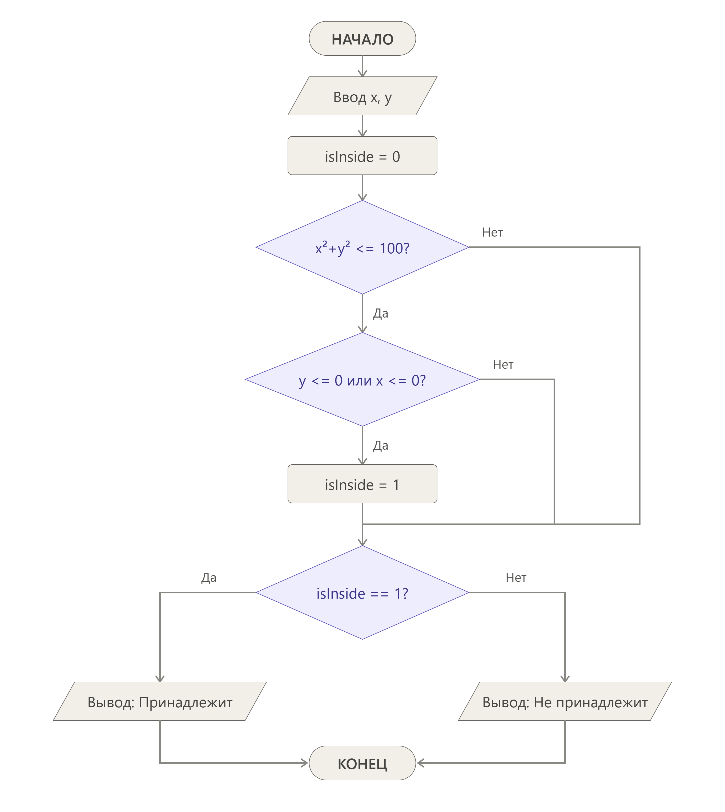

# Домашнее задание к работе 6

## Условие задачи
**Написать программу, которая определяет, принадлежит ли точка с заданными координатами (x, y) заштрихованной области. Область лежит внутри круга радиусом 10 с центром в начале координат и состоит из двух частей: четверти круга (при x ≤ 0, y ≥ 0) и нижнего полукруга (при y ≤ 0). Верхняя правая четверть круга (при x > 0, y > 0) в область не входит.**

---

## 1. Алгоритм и блок-схема

### Алгоритм
1. **Начало**
2. **Ввод данных:**
   - Считать координату x
   - Считать координату y
3. **Инициализация:**
   - Установить флаг принадлежности `isInside = 0`
4. **Проверка условий:**
   - Если `x * x + y * y <= 100` (точка внутри круга или на его границе):
     - Если `y <= 0` или `x <= 0` (точка не в верхней правой четверти) → `isInside = 1`
5. **Вывод результата:**
   - Если `isInside == 1` → Вывести "Точка принадлежит области"
   - Иначе → Вывести "Точка не принадлежит области"
6. **Конец**
   
### Блок-схема
 
## 2. Реализация программы
```c
int TaskDZ() {
    double x, y;
    const double R = 10;
    int isInside = 0;

    printf("Введите координату x: ");
    scanf("%lf", &x);
    printf("Введите координату y: ");
    scanf("%lf", &y);

    if (x * x + y * y <= R * R) {
        if (y <= 0 || x <= 0) {
            isInside = 1;
        }
    }

    if (isInside) {
        printf("Точка (%.2f, %.2f) принадлежит области\n", x, y);
    }
    else {
        printf("Точка (%.2f, %.2f) не принадлежит области\n", x, y);
    }

    return 0;
}
